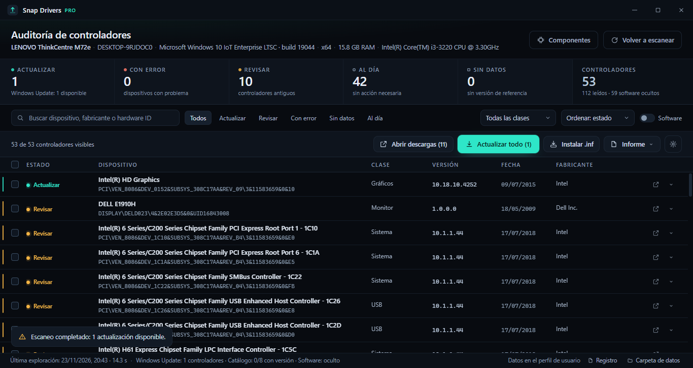
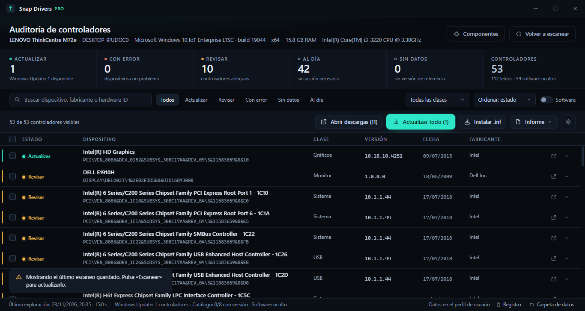
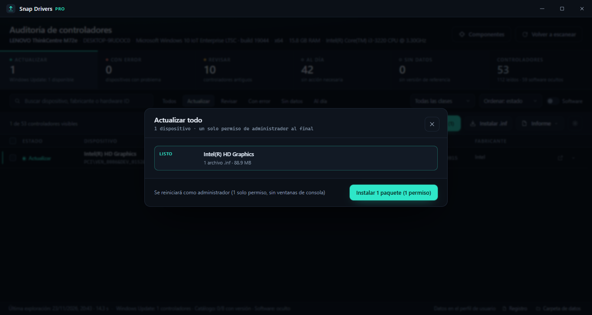
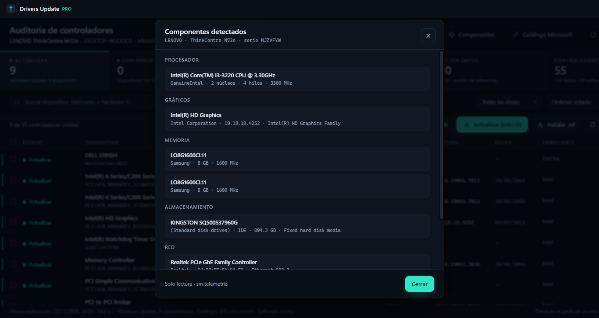
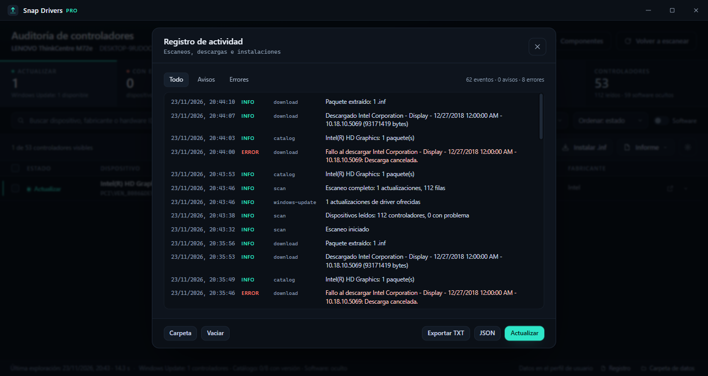
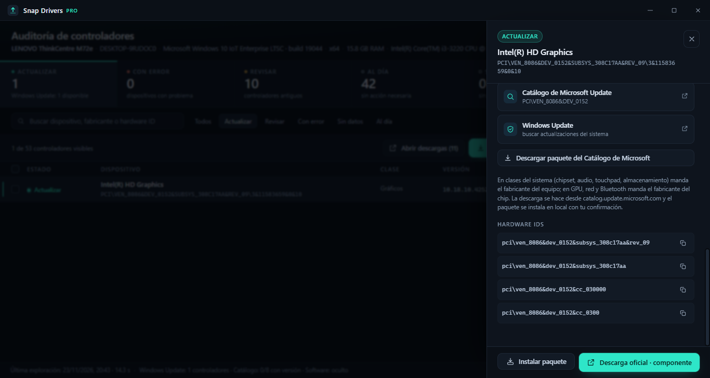
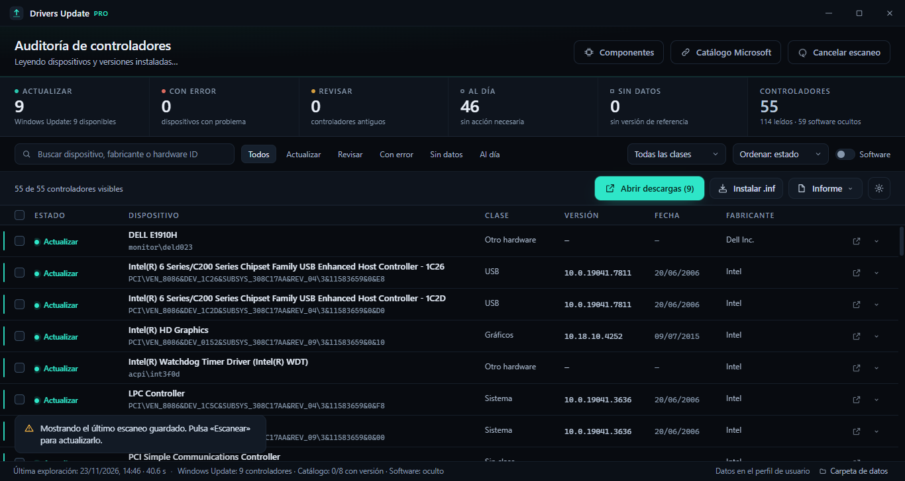
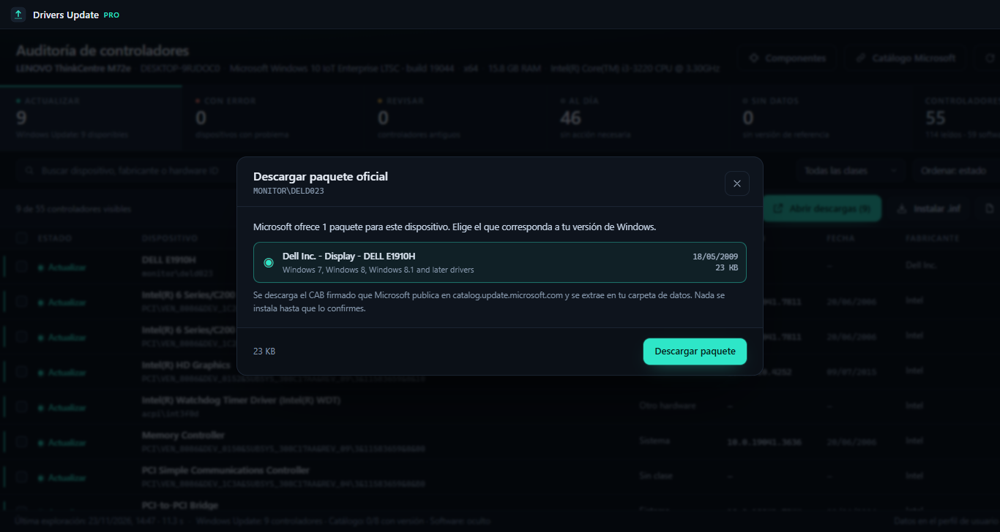

# Snap Drivers Pro

Actualizador de controladores para Windows 10/11 x64. Escanea el equipo, dice qué controladores están
desactualizados, descarga el paquete **oficial** de Microsoft y lo instala con un solo permiso. Se actualiza
solo desde GitHub y todos los datos se guardan en tu carpeta.





## Qué hace

- **Escaneo completo**: enumera todos los controladores instalados (`Win32_PnPSignedDriver`) con versión,
  fecha, proveedor, firma, INF, hardware IDs y estado PnP. También detecta dispositivos con error, aunque no
  tengan controlador.
- **Actualizaciones reales**: consulta Windows Update (`Microsoft.Update.Session`, categoría *Drivers*) y
  empareja cada paquete con su dispositivo por hardware ID.
- **Catálogo local ampliable**: un JSON editable donde anotas la última versión conocida de cada familia
  (Intel, NVIDIA, AMD, Realtek, Qualcomm…). Con ese dato la app compara versiones; sin él nunca inventa un
  «al día».
- **Rutas oficiales por controlador**: chip según `VEN_`/`VID_` (con página propia por clase: audio,
  red, gráficos, almacenamiento), Catálogo de Microsoft Update por hardware ID, y **fabricante del equipo**
  con **marca, modelo, versión de producto y número de serie** listos para copiar. Dell abre además la ficha
  exacta del equipo por etiqueta de servicio.
- **Cobertura amplia**: 100+ identificadores de fabricante de componente y 30+ fabricantes de equipo,
  incluidos los portátiles gaming (Legion, ROG/TUF, Predator/Nitro, OMEN/Victus, Alienware, MSI, Razer
  Blade, AORUS, XMG, Clevo/Tongfang, Framework…). Si un dispositivo no está en la tabla, siempre queda la
  búsqueda por hardware ID en el catálogo oficial.
- **Descarga integrada** desde el Catálogo de Microsoft Update: para cada hardware ID la app lista los
  paquetes que Microsoft publica (título, productos, fecha, tamaño), descarga el CAB oficial con progreso y
  lo extrae en tu carpeta de datos.
- **Actualizar todo con un solo permiso**: descarga y extrae en cola todos los paquetes de las
  actualizaciones detectadas y los instala de una vez con **una única** confirmación de administrador.
  Búsqueda con variantes de hardware ID, reintentos, segundo analizador del HTML y caché de 24 h: si
  Microsoft cambia su página, la app sigue sirviendo la última lista conocida.
- **Instalación por hardware ID**: de cada paquete se aplica solo el `.inf` que declara el hardware ID del dispositivo (un CAB de Intel con 39 `.inf` instala el suyo, no los 38 restantes).
- **Instalación manual asistida**: eliges el `.inf` (o la carpeta) —descargado por la app o por ti— y se
  aplica con `pnputil /add-driver /install`, elevando solo esa operación y, si quieres, creando antes un
  punto de restauración.
- **Inventario del equipo**: procesador, gráficos, memoria (módulo a módulo), almacenamiento, red, audio y
  batería, con sus versiones.
- **Comprobar versión de verdad**: con un clic, la app descarga el paquete que Microsoft publica para ese
  hardware ID, lee la versión del INF y la compara con la instalada. Queda cacheada una semana y los escaneos
  posteriores comparan solos.
- **Descargar e instalar sin pasar por la web**: el botón principal del detalle baja el paquete del catálogo,
  lo extrae e instala; los enlaces al fabricante siguen ahí como alternativa.
- **Resolver los «Revisar»**: cuando ya comprobaste un controlador en la web del fabricante, **Marcar al día**
  (por fila o en lote) lo cierra para esa versión exacta y se guarda en `verificados.json`. Si la versión
  cambia, el aviso vuelve.
- **Informes**: HTML autocontenido, CSV para Excel y JSON con todo el modelo de datos.





## Instalación sin ventanas de consola

La app **no abre ninguna ventana de PowerShell**:

- Si ya corre como administrador, ejecuta `pnputil` directamente (sin consola ni UAC).
- Si no, guarda la cola, se reinicia con permisos de administrador (un solo aviso de UAC) y continúa la
  instalación en segundo plano. El resultado aparece en la ventana de la app.

Tras instalar, el dispositivo pasa a **Al día · instalado por Snap Drivers Pro** en el siguiente escaneo
(registro en `instalados.json`), en lugar de quedarse en «Revisar» por antigüedad.

## Códigos de pnputil que no son errores

| Código | Significado | Cómo lo trata la app |
| --- | --- | --- |
| 0 | Correcto | Instalado |
| **3010 / 1641** | Correcto, **requiere reiniciar** | Instalado · «reinicia para completarlo» |
| **259** | Paquete añadido al almacén, ningún dispositivo lo reclamó aún | Aviso · se ejecuta `pnputil /scan-devices` al terminar el lote |
| 5 | Acceso denegado | Error (UAC) |
| 87 | Parámetro inválido | Error (se corrigió: ya no se usa `/subdirs`) |

## Registro y reportes

El botón **Registro** de la barra inferior abre todo lo que hizo la app: escaneos, consultas a Windows Update,
búsquedas en el catálogo, descargas, extracciones e instalaciones con su código de `pnputil`. Se puede
filtrar por avisos/errores, exportar a TXT o JSON y abrir la carpeta `Registros/`.



## Quién manda en cada clase

| Clase | Fuente primaria |
| --- | --- |
| Chipset, audio, touchpad, lector de huellas, tarjetas, cámara, BIOS, energía | **Fabricante del equipo (OEM)** |
| Gráficos, red, Wi-Fi, Bluetooth, periféricos | **Fabricante del componente** |
| Todo lo demás | Catálogo de Microsoft Update por hardware ID |

Ambas rutas están siempre visibles en el detalle, con la primaria marcada. La regla evita el fallo clásico
de instalar el driver de audio genérico en un portátil y perder altavoces, micrófono o teclas de función.

## Cómo se decide el veredicto

| Nivel | Cuándo | Fuente |
| --- | --- | --- |
| **Actualizar** | Windows Update ofrece un paquete para ese hardware ID, o el catálogo local tiene una versión mayor que la instalada | `windows-update` / `catalog` |
| **Con error** | El dispositivo reporta un código de problema (28 = falta el controlador) | PnP |
| **Al día (sin referencia)** | Controlador de terceros antiguo sin paquete más nuevo en Windows Update; el detalle lo explica y **Comprobar versión** obtiene la referencia real | `age` |
| **Al día** | Versión igual o mayor que la de referencia (catálogo, paquete del catálogo o verificación manual), o controlador incluido en Windows | `catalog` / `catalog-package` / `verified` |
| **Sin datos** | No hay versión de referencia ni antigüedad suficiente para afirmar nada | — |

Cada fila muestra el motivo textual, no solo un color.

## Lo que este programa **no** hace (a propósito)

- No mantiene una base de datos propia de millones de controladores ni replica la de un competidor: eso
  exige un servidor, contratos con fabricantes y mantenimiento diario.
- No descarga ni instala nada automáticamente. Toda escritura en el sistema pasa por un diálogo nativo y el
  aviso de UAC.
- No hace scraping de las webs de los fabricantes ni del Catálogo de Microsoft: genera enlaces oficiales y
  abre tu navegador.
- No envía ni un byte a servidores propios. No hay analítica, ni cuentas, ni actualizaciones forzadas.



## Uso

1. Ejecuta `Snap Drivers Pro.exe` (no requiere instalación ni permisos de administrador para escanear).
2. Pulsa **Escanear equipo**. En ~15 s verás todos los controladores clasificados (mientras tanto, esqueletos y progreso por fases: dispositivos → Windows Update → cruce de fuentes).

   
3. Filtra por estado, clase o busca por texto (dispositivo, fabricante, versión, hardware ID).
4. Para cada actualización: **Descarga oficial** abre la ficha del fabricante o el Catálogo de Microsoft
   Update. Descarga el paquete en el navegador.
5. O descarga sin salir: en el detalle del controlador, **Descargar paquete del Catálogo de Microsoft** → elige el paquete → *Extraer e instalar*.

   

6. Vuelve a la app → **Instalar .inf** → elige el `.inf` o la carpeta descomprimida → confirmar UAC.
7. Opcional: **Informe** para exportar HTML/CSV/JSON.

Atajos: `/` o `Ctrl+F` enfoca la búsqueda, `Esc` cierra el detalle o el diálogo.

## Dónde se guardan los datos

- **Portable** (recomendado): carpeta `DriversUpdatePro` junto al `.exe` — `settings.json`,
  `catalog.json`, `ultimo-escaneo.json` e `Informes/`.
- **Desarrollo**: `%APPDATA%\Snap Drivers Pro\`.

El pie de la ventana siempre muestra la ruta real y el botón **Carpeta de datos** la abre.

## Desarrollo

```bash
npm install
npm start          # ejecuta la app
npm test           # 31 pruebas del motor, las rutas y la descarga del catálogo
npm run icon       # regenera build/icon.ico sin dependencias de imagen
npm run dist            # instalador NSIS (auto-actualizable) → dist/Snap-Drivers-Pro-Setup.exe
npm run dist:portable   # versión portable, sin instalación
npm run release         # compila y publica la release en GitHub (requiere gh auth / GH_TOKEN)
```

### Estructura

```
src/main/         proceso principal (Node): escaneo, catálogo, veredictos, instalación, informes
src/main/scripts/ PowerShell: scan-system, wu-drivers, install-inf, restore-point
src/preload/      puente contextBridge con lista blanca de canales
src/renderer/     interfaz (HTML/CSS/JS, sin bundler)
data/             catálogo de referencia incluido
test/             node:test del motor puro
scripts/          generador de icono
```

## Seguridad

- `contextIsolation: true`, `sandbox: true`, `nodeIntegration: false`, CSP estricta sin `connect-src`.
- El renderer nunca recibe acceso a `ipcRenderer`: solo funciones concretas del preload.
- Los enlaces externos se validan contra una lista blanca de dominios oficiales antes de abrirse.
- La elevación solo se aplica a una ruta `.inf`/carpeta previamente elegida en el diálogo nativo del sistema.
- Los scripts de PowerShell se ejecutan con `-NoProfile -ExecutionPolicy Bypass`, salida JSON y timeout.

## Limitaciones conocidas

- «Al día» significa «igual o más nuevo que la referencia que tengas en el catálogo», no una garantía del
  fabricante. Sin entrada en el catálogo ni paquete en Windows Update, la app dice **Sin datos**.
- Windows Update puede estar deshabilitado por directiva: la app lo indica y sigue funcionando con el resto.
- `pnputil` rechaza paquetes sin firma válida o de otra arquitectura; el error se muestra tal cual.
- Solo Windows x64 (Windows 10 22H2 y 11). En ARM64 la app arranca por emulación y lo advierte: algunos
  fabricantes solo publican paquetes ARM64 en su web.
- No gestiona firmware/UEFI ni controladores que solo se instalan con el `.exe` del fabricante (para eso,
  abre su web desde la ruta oficial).
- En clases del sistema manda el OEM: si su paquete es más antiguo que el del chip, la app muestra las dos
  rutas y explica cuál es la primaria.

## Documentación del dominio

- [`GLOSSARY.md`](GLOSSARY.md) — qué es un controlador, un veredicto, una ruta oficial y qué significa
  exactamente «al día».
- [ADR 0001](docs/adr/0001-sin-base-de-datos-de-drivers.md) — por qué no hay base de datos propia y qué se
  pierde a cambio.

## Firmar el ejecutable (opcional, quita el aviso de SmartScreen)

Sin firma, Windows SmartScreen avisa la primera vez. Para firmarlo, exporta el certificado y compila:

```bash
export CSC_LINK=/ruta/al/certificado.pfx
export CSC_KEY_PASSWORD=tu-contraseña
npm run dist
```

## Cuando Windows no acepta el paquete

Hay controladores que entran en el almacén (pnputil devuelve 0) pero **Windows nunca enlaza al dispositivo**:
el caso típico son gráficos antiguos donde el paquete del catálogo no corresponde a esta máquina. Windows Update
seguirá ofreciéndolo, así que la app lo registra en `no-aplica.json` y:

- La fila pasa a **Al día · no aplicable** con el motivo («sigue en la versión X; usa el instalador del
  fabricante») y **deja de pedirlo**.
- El detalle muestra un aviso, cambia el botón principal a **Web del fabricante** y ofrece **Reintentar**
  (olvida el intento para probar otra vez).
- Si algún día la versión instalada cambia, el registro deja de aplicar y el aviso vuelve.

## Instalado de verdad vs. pendiente de reinicio

Tras aplicar un paquete, la app **vuelve a leer la versión real del dispositivo**:

- Si cambió → **Instalado** y la fila pasa a «Al día».
- Si Windows mantiene la anterior hasta reiniciar (habitual en tarjetas gráficas) → **Instalado · reinicia para
  aplicarlo**, con la versión que sigue activa, y la fila deja de mostrar «Actualizar».
- Si el paquete no aplica, el siguiente escaneo vuelve a mostrarlo como actualización: la app no finge.

## Cómo se instala (y por qué ya no se queda cargando)

Al pulsar **Descargar e instalar**, la app pide **un único permiso de Windows** y se queda abierta esperando:

- Si aceptas, el paquete se aplica en segundo plano y ves el progreso por paquete («Instalando 2/9 · …»).
- Si cancelas, aparece «Permiso de administrador cancelado» y puedes reintentar sin perder la descarga.
- Un vigilante de 9 minutos evita que la ventana se quede cargando para siempre; si salta, el propio aviso
  enlaza al Registro.

Las versiones anteriores guardaban la cola y reiniciaban la app elevada; si ese reinicio no llegaba a
completarse, la interfaz se quedaba en «Instalando con permisos de administrador…». Ese camino ya no existe.

## Si una actualización deja la app sin arrancar

Una actualización interrumpida puede dejar `app.asar` a medio reemplazar. Desde la 2.3.0 la app no muestra el
diálogo de error de JavaScript: registra el fallo en `Registros/arranque.log` y, si el archivo está dañado,
muestra un aviso corto pidiendo reinstalar. El instalador se aplica ahora con la app cerrada
(`quitAndInstall(true, true)`) para que el archivo no quede bloqueado. Antes de publicar, `npm run verify:build`
comprueba que todos los JS del `asar` compilan y coinciden con el fuente.

## Actualizaciones automáticas

La versión instalada comprueba las releases del repositorio al arrancar y cada 6 horas. Si hay una versión
nueva aparece una ventana con la nota de la release y el botón **Instalar actualización**: descarga el
instalador, lo aplica y conserva ajustes, catálogo, descargas y registro. También se puede forzar desde
**Ajustes → Buscar actualizaciones**.

### Cómo se ve el aviso

Al arrancar (y cada 6 horas) la app consulta las releases. Si hay una versión nueva:

- Aparece una **píldora en la barra de título**: `● Actualización X.Y.Z`, con un punto que parpadea.
- Se abre un diálogo con la versión, la nota de la release y los botones **Instalar actualización** /
  **Más tarde**. «Más tarde» cierra el diálogo pero deja la píldora (al pulsarla vuelve a abrirse).
- Durante la descarga la píldora muestra el porcentaje; al terminar, «Reiniciar para instalar».
- El engranaje de ajustes muestra un punto mientras haya una actualización pendiente.

### Publicar una versión

```powershell
# 1) una sola vez: autenticarse y crear repo + Pages
gh auth login
.scriptssetup-github.ps1

# 2) cada vez que quieras publicar (sube antes la versión en package.json)
.scripts
elease.ps1 -Note "Corrige X"
```

El script corre las pruebas, hace commit y push, compila el NSIS con `latest.yml` y crea la release.
Los clientes ven el aviso en su siguiente arranque.

## Web de descarga

La landing vive en **https://snapdrivers.profilebio.me** (GitHub Pages con dominio propio, declarado en
`docs/CNAME`; también responde en `https://profilebiome.github.io/snapdriverspro/`).
El botón apunta a la descarga directa del último instalador:

```
https://github.com/profilebiome/snapdriverspro/releases/latest/download/Snap-Drivers-Pro-Setup.exe
```

Ese enlace descarga el archivo sin abrir la página de GitHub; el nombre del artefacto queda fijo
(`Snap-Drivers-Pro-Setup.exe`) para que el enlace no cambie entre versiones.

## Instalador vs portable

- **Instalador** (`Snap-Drivers-Pro-Setup.exe`, ~116 MB): instalación por usuario sin UAC, acceso directo,
  desinstalador y **auto-actualización**.
- **Portable** (`npm run dist:portable`): un único `.exe` con datos junto a sí mismo; sin auto-actualización.
- La primera vez, la app migra los datos de `Drivers Update Pro` (ajustes, catálogo, descargas).

## Licencia

MIT. No está afiliado a Microsoft, Intel, NVIDIA, AMD ni a ningún fabricante mencionado.
